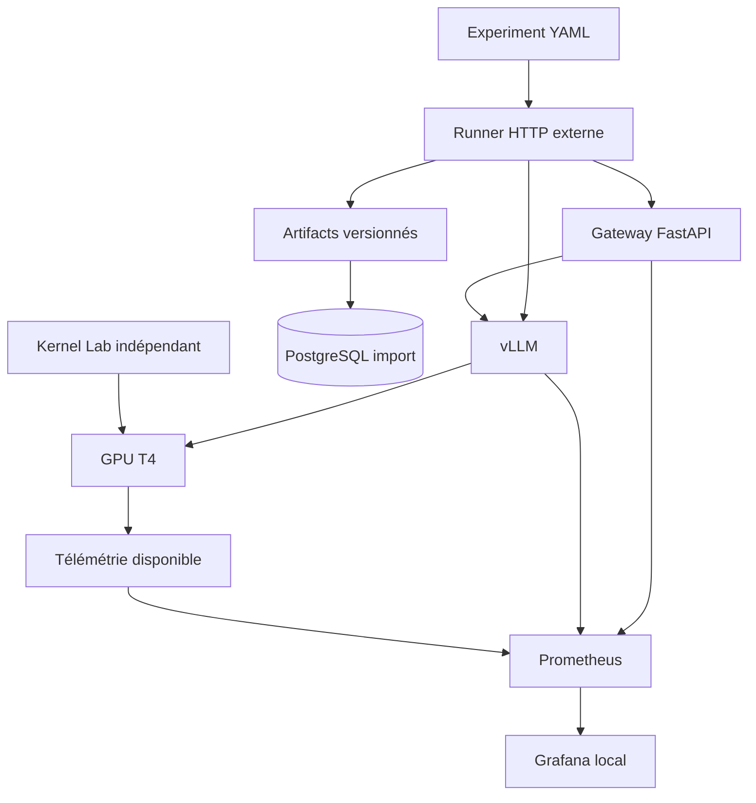

# InferenceLab — Project Design Document v1.2

**Version :** 1.2 — **Date :** 17 octobre 2026  
**Statut :** design corrigé avant implémentation ; qualification GPU à réaliser  
**Projet :** Projet 15 — Portfolio LLM Inference / GPU Performance Engineering

## 1. Vision et résultat attendu

InferenceLab permet de déployer, observer, benchmarker et comparer des configurations
de serving LLM vLLM sur GPU, puis d'évaluer des SLO et régressions lorsque les données
permettent de conclure. Le produit est la capacité à caractériser la performance,
à expliquer les compromis et à conserver des preuves reproductibles.

Deux volets : mesure système (latence, débit, scheduler, KV cache, télémétrie) et
Kernel Lab RMSNorm indépendant (PyTorch eager, torch.compile, Triton).
Un gain kernel ne prouve pas un gain serving. L'intégration kernel dans vLLM reste
optionnelle. Le projet n'est ni chatbot, ni RAG, ni plateforme MLOps généraliste.

## 2. Autorité des documents et contrats

Ce PDD définit le scope et les décisions. [BENCHMARK_CONTRACT.md](BENCHMARK_CONTRACT.md)
définit de façon normative les métriques, schémas, populations, artifacts et verdicts.
Les prompts mettent ces deux documents en œuvre ; une contradiction doit être corrigée
avant de coder, pas résolue par une convention locale. Les exemples non qualifiés ne
sont pas des preuves de compatibilité ou de performance.

Le contrat est versionné indépendamment : `schema_version="1.0"` pour l'expérience et
la policy, `result_schema_version="1.0"` et `metric_contract_version="1.0"` au résultat.
Un seul YAML canonique, une seule syntaxe policy ; aucun seuil SLO inline concurrent.

## 3. Utilisateur et questions

Utilisateur : ML/Inference Engineer sélectionnant ou optimisant une configuration
sur un hardware donné. Questions : concurrence et saturation, coût du contexte,
effet de quantification, compromis TP, écart direct/gateway, régression de runtime,
comportement d'une primitive GPU. Les conclusions restent bornées au protocole mesuré.

## 4. Architecture et responsabilité des composants

Ce diagramme est logique : il ne suppose pas de connexion Prometheus locale vers un
notebook Kaggle distant. Sur Kaggle, les mesures disponibles sont exportées en artifacts.

- **Control plane :** CLI qui valide l'expérience, vérifie la cible et son manifeste,
  exécute des points de mesure, produit des artifacts et compare les résultats.
- **Inference plane :** gateway séparé et vLLM serveur externe. FastAPI ne charge pas
  le modèle ; le runner ne vit pas dans le serveur.
- **Observabilité :** logs JSON, métriques runtime/gateway et télémétrie GPU accessibles.
- **Stockage :** artifacts canoniques ; PostgreSQL indexe les imports idempotents.
- **Registry :** sélection/configuration explicite d'une révision ; découverte automatique
  après le MVP, sans téléchargement ni promotion automatiques.
- **Kernel Lab :** code séparé, jamais exécuté simultanément à une mesure serving.

## 5. Profils de déploiement

| Profil | Composants et règle |
| --- | --- |
| Local / CI CPU | Mock, gateway, tests, PostgreSQL et configurations Prometheus/Grafana ; aucun poids requis |
| Kaggle GPU | vLLM, runner, gateway si testé, collecte GPU légère ; processus CLI, HTTP loopback, artifacts sans DB |
| Docker GPU dédié | Profil Compose facultatif pour un hôte compatible ; ne prouve pas la compatibilité Kaggle |

Pas d'hypothèse Docker Compose, systemd, service persistant ou tunnel vers le laptop
pour une campagne Kaggle. Une erreur PostgreSQL ne doit pas invalider un artifact
déjà correctement produit ; une absence d'artifact empêche en revanche un verdict publié.

## 6. Qualification hardware/software avant implémentation

Cible : Kaggle, deux NVIDIA Tesla T4, SM 7.5, 16 GB nominaux par GPU, mémoire séparée.
Baseline : un GPU, FP16 explicite, TP=1 ; TP=2 est une variable exploratoire.
Ni le second GPU, ni sa topologie, ni une version de package ne sont supposés disponibles
sans observation. Le nombre de GPU utilisés est distinct des GPU présents/visibles.

Exécuter [00B_T4_COMPATIBILITY_QUALIFICATION.md](00B_T4_COMPATIBILITY_QUALIFICATION.md)
avant de considérer la stack GPU comme acquise. Qualifier environnement isolé,
vLLM/backend d'attention, streaming/usage/EOS, Triton et torch.compile par exécution.
Le support Triton annoncé actuellement à partir de SM 8.0 impose cette vérification
sur T4 ; il ne prouve pas l'échec de toutes les versions ou de tous les kernels.

Figer seulement les versions effectivement validées et conserver logs/commandes.
Python 3.12 est la cible CPU et le premier candidat GPU, pas une compatibilité GPU
déjà prouvée. Pas de changement implicite de dtype, backend ou matériel pour passer.
Sans accès GPU, tests CPU possibles ; qualification marquée `not_tested`, jamais validée.

## 7. Modèles et expériences contrôlées

Un checkpoint Qwen ~3B est le modèle principal du portfolio : FP16, TP=1, une T4.
Candidat initial : `Qwen/Qwen2.5-3B-Instruct`, à qualifier et figer par commit immuable.
Le checkpoint reste configurable ; aucun poids n'est téléchargé par les tests CPU.

AWQ : variante issue du même modèle source, provenance vérifiée, tokenizer compatible,
un GPU et TP=1 dans les deux conditions. Enregistrer révision et chemin quantifié effectif.
Une comparaison entre tailles différentes n'isole pas la quantification.

TP : même checkpoint FP16, mêmes paramètres et workload, TP=1/1 GPU contre TP=2/2 GPU,
après qualification. Si une condition ne tient pas, ne pas publier une accélération TP
à partir d'un checkpoint différent. Les ~7B sont des variantes optionnelles ; un
7B FP16/TP2 versus AWQ/TP1 compare des déploiements, pas l'effet isolé d'AWQ.

Champs configurables : repo/révisions immuables, tokenizer/template, dtype,
quantification, TP, limites de contexte, scheduler et mémoire. Leur valeur effective
est vérifiée dans un manifeste runtime, distinct du YAML attendu.

## 8. Workloads et génération

| Workload | Entrée cible après template | Sortie cible | Objet |
| --- | ---: | ---: | --- |
| short-chat-v1 | 128 tokens | 128 tokens | Interaction synthétique courte |
| long-context-v1 | 512 puis 2048 tokens | 128 tokens | Coût du prefill |
| generation-heavy-v1 | 128 tokens | 512 tokens | Régime decode |

Dataset JSONL versionné, non sensible, hash SHA-256 et plan déterministe conservés.
Enregistrer tokenizer/révision, hash/paramètres de template, longueurs réelles et
paramètres de génération. Sampling et EOS explicites ; génération synthétique de
longueur contrôlée seulement avec un mécanisme réellement qualifié.
Entrée + sortie <= `max_model_len`. Tailles 4k/8k conditionnelles, pas nécessaires au
parcours initial. Le contrat décrit les échecs de conformité et les tokens d'usage.

## 9. Charge et protocole

Modèle fermé à C workers sans think time : C = 1/4/8/16/32 lorsque qualifié. Pas
d'affirmation de comportement sous taux d'arrivée indépendant. Pool HTTP dimensionné,
payloads préparés, aucun retry, warmup drainé et campagnes séquentielles.

Prefix caching désactivé pour la référence. Fixer et enregistrer chunked prefill,
CUDA graphs/eager, limites scheduler, budget mémoire et KV dtype. Warmup séparé par
point et couvrant les shapes. Le nombre de warmup seul ne démontre pas la stabilité.

Smoke court = fonctionnement. Exploration possible à 200 requêtes/run, descriptive.
Pour comparaison publiée avec gate : trois répétitions minimum par configuration,
ordre alterné, plans appariés ; volume et marge de bruit calibrés avant la candidate.
Résultats par répétition ; pas de p95 calculé par moyenne de p95.

## 10. Métriques

Définitions exactes dans le contrat : TTFT client au premier contenu non vide,
E2E jusqu'à fin valide du stream, TPOT de réception estimé et explicitement nommé,
débits de requêtes/tokens réussis sur la même fenêtre finie incluant les échecs,
error rate sur toutes les tentatives.

Une trame SSE n'est pas un token ; pas d'ITL exacte reconstruite depuis des chunks.
`null` + raison si indisponible. Percentiles sur succès documentés avec erreurs,
timeouts, couverture et nombre d'observations. Horloge monotone du runner.
Sources client/runtime/GPU distinctes ; métriques Prometheus pour diagnostic.
TTFT ne suppose pas une phase séparée de premier decode après le prefill.

GPU : utilisation, mémoire, température et puissance lorsque disponibles. Runtime :
running/waiting requests, KV cache et métriques prefill/decode réellement exposées
par la version retenue. Compteurs indisponibles explicitement signalés.

## 11. Expériences phares

| Expérience | Variable contrôlée | Restrictions |
| --- | --- | --- |
| A — Concurrence | C | Même workload, modèle, runtime et protocole |
| B — Quantification | FP16/AWQ | Même modèle source et ressources ; exploration |
| C — Contexte | Taille d'entrée | Sortie contrôlée, limites runtime cohérentes |
| D — Configuration serving | Une variable déclarée | Différences effectives enregistrées |
| E — RMSNorm | Implémentation | Correctness avant performance ; laboratoire indépendant |
| F — TP | TP et nombre de GPU | Même checkpoint/dtype ; exploration conditionnelle |
| Chemin HTTP | Direct/gateway | Même serving, ordre alterné, pas de soustraction de p95 assimilée à un overhead individuel |

Éviter une matrice cartésienne exhaustive. Chaque expérience a une hypothèse,
un plan, des artifacts, une interprétation et des limites. Aucun gain exigé comme résultat.

## 12. Gateway et confidentialité

Sous-ensemble documenté `POST /v1/chat/completions`, streaming obligatoire pour le
benchmark, validation, request ID, timeouts, error mapping, metrics/logs et annulation.
Pas de modèle, de génération, de retry automatique ni de stockage bloquant dans FastAPI.
Erreurs après début du flux traitées comme erreurs de stream et journalisées.

Ne pas logger prompts/réponses complets, Authorization, clés ou tokens d'accès.
Metadata utiles : request/run ID, modèle, compteurs, statut, durées correctement
instrumentées et erreur normalisée. Distinguer écart direct/gateway et temps du proxy.

## 13. Résultats et stockage

Un `campaign_id` regroupe des `run_id` ; un run = une configuration, un workload,
une concurrence, une répétition. Schéma brut et arborescence dans le contrat.
JSON et `raw/requests.jsonl` font autorité, agrégats recalculables ; exporter aussi
environment, manifeste runtime, logs et sorties NVIDIA. Préserver les runs incomplets.

PostgreSQL : experiment_runs, résumés/mesures et metadata de requêtes importés sans
contenu ; import idempotent par run_id. Pas de séries Prometheus, de logs massifs ou
de traces token-level en base. Aucun besoin DB pour exécuter une campagne Kaggle.

## 14. SLO, régression et comparabilité

Policy unique versionnée, associée au workload, calibrée séparément puis figée.
Les anciens 500 ms/40 ms/1 % sont des exemples historiques, pas une baseline acquise.
Le contrat fixe syntaxe et algorithme conservateur de décision avec marge de bruit.
SLO empirique sur un échantillon != garantie statistique du taux d'erreur sous-jacent.

Comparaison : `regression` ou `exploratory` + changements autorisés explicites.
Hardware utilisé/topologie, modèle/source, tokenizer/template, plan, longueurs,
concurrence, cible, protocole et contrat métrique sont vérifiés. Une version runtime
peut changer lorsque c'est précisément l'objet déclaré du gate.

Verdicts : PASS (0), FAIL (1), INCONCLUSIVE (2), INVALID (2), raisons structurées.
Pas de PASS faute de métrique, pour un run incomplet ou dans une zone de bruit non résolue.

## 15. Observabilité et Grafana

MVP système : logs structurés, métriques gateway et runtime disponibles, collecte GPU
légère et artifacts exploitables. Prometheus local prêt pour mock/hôte accessible.
Grafana est un livrable d'analyse du portfolio après ce MVP, pas une dépendance d'une
campagne Kaggle. DCGM est facultatif ; ne pas le supposer disponible dans un notebook.
Les panels utilisent uniquement les noms de métriques confirmés et leur source.
OpenTelemetry reste optionnel et inactif.

## 16. Kernel Lab

Volet requis pour déclarer le **portfolio complet**, après le MVP système et sous
réserve de qualification de la stack GPU. Pas de reclassification en bonus silencieux
en cas d'incompatibilité : documenter le blocage et la décision nécessaire.

RMSNorm : référence PyTorch, torch.compile exécuté réellement si qualifié, kernel
Triton correct, plusieurs shapes/hidden sizes/seeds et FP16 initial. Tests de correctness
avec tolérances explicites avant benchmark. Warmup, compilation initiale exclus,
synchronisation correcte, latence µs, speedup et bandwidth seulement si bien définie.
Conserver environnement et résultats bruts. Procédure de profiling documentée sans
outil GPU obligatoire en CI CPU.

Intégration vLLM : optionnelle, seulement après Kernel Lab fiable et point d'extension
vérifié. Pas de remplacement de FlashAttention, GEMM custom ou fork vLLM par défaut.
Correctness opération, génération réelle et mesure end-to-end distinctes.

## 17. Code, tests et CI

`src/inference_lab/` contient gateway, benchmark, registry léger, telemetry, storage et
config ; `kernel_lab/` reste indépendant. Dossiers experiments, dashboards, deploy,
kaggle, results, tests et docs. Un seul chemin de télémétrie : `telemetry/`.

Python typé, Pydantic v2, FastAPI, httpx, SQLAlchemy/Alembic, pytest, Ruff, mypy.
Tests CPU sans import GPU obligatoire ni téléchargement de poids. CI CPU mise en
place tôt ; tests GPU explicites, jamais déclarés exécutés parce qu'ils ont été skippés.
Tester config, SSE, erreurs partielles, annulation, agrégation, verdicts et import.

## 18. Scope et jalons

**MVP système :** YAML canonique -> runner direct puis gateway streaming -> vLLM ->
mesures/artifacts -> comparaison et quatre verdicts ; logs/métriques, télémétrie
accessible, import PostgreSQL local, Compose CPU, tests/CI et runbook Kaggle.

**Portfolio complet :** MVP, campagnes contrôlées réellement exécutées, Grafana
d'analyse, Kernel Lab qualifié et rapport démontrant résultats et limites.

**Après ces jalons :** découverte automatique de révisions, CI GPU dédiée, tracing et
intégration kernel optionnelle. Voir [OPTIONAL_STRETCH.md](OPTIONAL_STRETCH.md).
Les [SHOULD_IMPROVE.md](SHOULD_IMPROVE.md) sont des recommandations distinctes,
pas des exigences implicitement implémentées par les prompts.

Non-objectifs : Kubernetes, multi-node, cluster distribué, entraînement, RAG, agents,
vector DB, LangChain, Kafka/Redis, orchestrateur cloud et frontend custom.

## 19. Ordre d'implémentation

1. Lire règles/PDD/contrat ; qualification T4 limitée (00B).
2. Bootstrap et schémas canoniques ; CI CPU dès le début.
3. Serving vLLM direct streaming, fake SSE et runner ; artifacts recalculables.
4. Orchestrateur et comparateur/gates sur fixtures puis mesures qualifiées.
5. Gateway streaming et validation direct/gateway.
6. Télémétrie, runbook Kaggle final, import PostgreSQL et observabilité locale.
7. Campagnes contrôlées, Grafana, Kernel Lab et rapport.
8. Extensions uniquement si explicitement sélectionnées.

Les tests, timeouts et redaction accompagnent les étapes ; ne pas les repousser à un
audit final. L'ordre détaillé des prompts et leurs dépendances figurent dans README.

## 20. Definition of Done et limites

Composant : scope respecté, tests pertinents réellement passés, lint/typecheck,
configuration/erreurs documentées. Expérience : hypothèse, config effective, warmup,
workload conforme, données brutes, environnement, répétitions et limites conservés.
Un lecteur peut exécuter le mock CPU, suivre le runbook GPU, recalculer un résultat,
comprendre un verdict et reproduire les cas RMSNorm qualifiés.

Risques explicites : stack T4/Triton non acquise, quota/session/stockage Kaggle,
variance et petits échantillons, communications TP, compteurs indisponibles.
Mesures : spike initial, chemins conditionnels, artifacts autonomes/exportés,
comparaisons appariées, aucun chiffre ou claim de compatibilité inventé.

## Qualification ID

Chaque campagne GPU publiée doit référencer un `qualification_id` pointant vers les artifacts de qualification de la stack réellement exécutée.

## Contingency Kernel Lab

Le hardware de référence du serving reste Kaggle/T4. Triton doit d'abord y être qualifié.

Si Triton n'est pas raisonnablement exécutable sur T4, l'échec est documenté. Le Kernel Lab peut ensuite être exécuté sur un GPU compatible séparément identifié si disponible. Ces résultats ne doivent jamais être mélangés avec les résultats serving T4.
